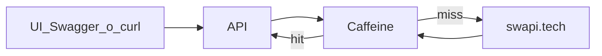

# Challenge Conexa — API Star Wars (SWAPI)

API REST en **Java 21 / Spring Boot** que integra [SWAPI](https://www.swapi.tech/) con autenticación JWT + roles, UI de demo con estética Star Wars, OpenAPI, tests y path de deploy en host gratuito.

Repo: https://github.com/duartegaston/challenge-conexa  
Autor: [duartegaston](https://github.com/duartegaston) (Gaston Duarte)

---

## Deploy (Fly.io)

| Recurso | URL |
|---------|-----|
| App | https://challenge-conexa.fly.dev |
| **Swagger UI** | https://challenge-conexa.fly.dev/swagger-ui/index.html |
| OpenAPI JSON | https://challenge-conexa.fly.dev/v3/api-docs |

Está en el plan free de Fly.io: la máquina puede apagarse por inactividad (**cold start**). El primer request puede tardar varios segundos en responder.

---

## Cómo correr (local)

### Requisitos

- Java 21+
- Maven 3.9+ (o el wrapper `./mvnw`)

### Arranque (perfil `local`, H2 en memoria + Flyway)

```bash
./mvnw spring-boot:run
```

| Recurso | URL |
|---------|-----|
| UI login | http://localhost:8080/ |
| UI catálogo | http://localhost:8080/app.html |
| Health | http://localhost:8080/actuator/health |
| **Swagger UI** | http://localhost:8080/swagger-ui.html |
| OpenAPI JSON | http://localhost:8080/v3/api-docs |

Perfil por defecto: `local` (H2 en memoria). Prod (Fly) usa **H2 file** en `/data`. Variables: `.env.example`.

---

## Credenciales

Usuarios sembrados al arranque si no existen (`UserDataSeeder`). Overrides: `SEED_USER_PASSWORD`, `SEED_ADMIN_PASSWORD`.

| Username | Password | Roles |
|----------|----------|-------|
| `user` | `user123` | USER |
| `admin` | `admin123` | USER, ADMIN |

Solo para demo. En prod hay que setear `JWT_SECRET` (Fly secrets) y las passwords de seed. Si el perfil `prod` arranca con el secreto vacío o con el default público de `application.yml`, el proceso termina al inicio.

### Login (curl)

```bash
curl -s -X POST http://localhost:8080/api/v1/auth/login \
  -H 'Content-Type: application/json' \
  -d '{"username":"user","password":"user123"}'
```

Respuesta: `{ "accessToken", "tokenType": "Bearer", "expiresIn", "roles" }`.

### Recursos (curl)

```bash
TOKEN=$(curl -s -X POST http://localhost:8080/api/v1/auth/login \
  -H 'Content-Type: application/json' \
  -d '{"username":"user","password":"user123"}' | jq -r .accessToken)

curl -s "http://localhost:8080/api/v1/people?page=1&limit=5&name=sky" \
  -H "Authorization: Bearer $TOKEN"

curl -s http://localhost:8080/api/v1/people/1 \
  -H "Authorization: Bearer $TOKEN"
```

Listado: `{ "content", "page", "limit", "total", "hasNext" }`.  
Filtro `name`/`title` → query remoto en SWAPI (`name` o `title`). Sin token → `401`.

---

---

## UI demo (look Star Wars)

1. http://localhost:8080/ — login (JWT en `sessionStorage`)
2. http://localhost:8080/app.html — tabs, filtro, paginación, detalle
3. 401 → vuelve al login

Tipografía Orbitron / Exo 2; fondo espacial; acentos oro crawl + azul sable.

---

## OpenAPI / Swagger

- UI: http://localhost:8080/swagger-ui.html  
- Spec: http://localhost:8080/v3/api-docs  
- Security scheme `bearerAuth` (JWT). Login es público; recursos llevan tag + `@SecurityRequirement`.  
- Flujo sugerido: `POST /api/v1/auth/login` → Authorize con el `accessToken` → probar `GET /api/v1/people`.

## Endpoints principales

Base: `/api/v1`.

| Método | Path | Auth | Notas |
|--------|------|------|-------|
| POST | `/api/v1/auth/login` | Público | Emite JWT |
| GET | `/api/v1/auth/me` | JWT | Perfil |
| GET | `/api/v1/people` | JWT + USER | `page`, `limit`, `name` |
| GET | `/api/v1/people/{id}` | JWT + USER | Detalle |
| GET | `/api/v1/films` | JWT + USER | `page`, `limit`, `name`/`title` |
| GET | `/api/v1/films/{id}` | JWT + USER | Detalle |
| GET | `/api/v1/starships` | JWT + USER | `page`, `limit`, `name` |
| GET | `/api/v1/starships/{id}` | JWT + USER | Detalle |
| GET | `/api/v1/vehicles` | JWT + USER | `page`, `limit`, `name` |
| GET | `/api/v1/vehicles/{id}` | JWT + USER | Detalle |
| GET | `/actuator/health` | Público | Liveness |
| GET | `/swagger-ui.html` | Público | OpenAPI + Authorize Bearer |

---

## Decisiones

Cada fila resume una decisión tomada.

| Decisión                                                                                         | Por qué                                                                                                                                                                                              |
| ------------------------------------------------------------------------------------------------ | ---------------------------------------------------------------------------------------------------------------------------------------------------------------------------------------------------- |
| **REST API**                                                                                     | REST API, Simplicidad y menor sobrecarga.                                                                                                                                                            |
| **JWT Bearer + Spring Security + roles.**                                                        | Stateless para API REST (UI, Swagger, curl) sin sesión en servidor. Spring Security + roles cubren authz sin OAuth/IdP (sobrepeso para el challenge) ni Basic Auth (poco apto para SPA).              |
| **Spring** `RestClient` **→ https://www.swapi.tech + timeouts + Caffeine**                       | SWAPI es la fuente de verdad; RestClient nativo del stack MVC; Caffeine mitiga latencia; no dependencias de terceros de dominio SW.                                                                  |
| **Controllers sin** `ResponseEntity` **envolviendo cada respuesta**                              | Controllers thin: el tipo de retorno + `@ResponseStatus` / defaults MVC fijan el status; errores vía `@RestControllerAdvice`. `ResponseEntity` solo si hiciera falta variar status/headers por rama. |
| **Paginación normalizada (**`PageResponse`**)**                                                  | Contrato estable hacia la UI; page/limit reenviados a SWAPI.                                                                                                                                         |
| **H2 + Flyway solo para** `UserEntity` **(auth/seed). Sin driver de PostgreSQL.**                | El challenge no persiste el catálogo de SWAPI. H2 en memoria (local/test) o en archivo (prod) alcanza. Flyway versiona el esquema; el driver de Postgres no está en el build. |
| **Maven + Java 21 + capas clásicas MVC**                                                         | Packages `config`/`controller`/`service`/`model`/`repository`/`security`/`client`/`exception`.                                                                                                       |
| **SonarCloud vía GitHub Action**                                                                 | Calidad visible cuando hay `SONAR_TOKEN`; no bloquea el MVP.                                                                                                                                         |
| **Deploy Fly.io + Docker multi-stage (Java 21)**                                                 | Free/hobby path; `JWT_SECRET` vía Fly secrets.                                                                                                                                                       |
| **Cursor + SDD (plan → fases → ejecución)**                                                      | Alcance controlado y entregas incrementales.                                                                                                                                     

---

## Metodología: Cursor + SDD

Utilicé Cursor para el desarrollo, con una metodología Spec Driven Development. Primero le di el contexto con todas las especificaciones, luego generé un plan con distintas fases de implementación puliendo detalles y tomando distintas decisiones. Finalmente luego de implementar cada fase realicé una review de lo desarrollado y por último la ejecución y pruebas.

1. **Plan** — alcance, ADRs y fases.
2. **Fases** — checklist + Definition of Done.
3. **Ejecución** — una fase a la vez.

Contexto para el agente: [`.cursor/CONTEXT.md`](.cursor/CONTEXT.md), rules en `.cursor/rules/` y la skill `.cursor/skills/java-spring-rest/`.

---

## Arquitectura en capas

```
com.conexa.challenge
├── config       # Security, OpenAPI, Cache, properties
├── controller   # Auth + resources REST (DTOs directos)
├── service      # Auth, catalog, people/films/starships/vehicles, seed
├── client       # SwapiClient (RestClient), mapper, properties
├── security     # JWT filter, JwtService, UserDetails
├── model        # UserEntity, Role + dto/
├── repository   # UserRepository
└── exception    # @RestControllerAdvice + excepciones de dominio
```

---

## SWAPI + caché

SWAPI es un servicio externo: cada listado o ficha suma latencia de red y, en Fly, el cold start ya es lento. La UI pagina y repite los mismos ids. Caffeine guarda esas respuestas en memoria del proceso para no volver a pegarle al origen en cada request igual.

No reemplaza a SWAPI. Si el dato no está, o venció el TTL, el cliente va al origen y guarda el resultado. Errores y 404 no se cachean: se lanzan antes de devolver un valor. El tope de entradas (`cache.swapi.max-size`, default 300) y el TTL corto (default 5 minutos) limitan la RAM en la VM de 512 MB.

Hay dos cachés para que la clave de una página no pise la de un detalle:

- `swapi-lists` — recurso + page + limit + filtro
- `swapi-details` — recurso + id



- **Origen:** https://www.swapi.tech/api (configurable `swapi.base-url`)
- **Cliente:** Spring `RestClient` (sin SDK Star Wars)
- **Timeouts:** `swapi.connect-timeout-ms`, `swapi.read-timeout-ms`
- **Errores:** origen caído → **502 Bad Gateway**
- Tests: WireMock / mocks — **nunca** red real a SWAPI en CI


---

## Tests

```bash
./mvnw clean test
```

| Tipo | Ejemplos |
|------|----------|
| Unit | `JwtServiceTest`, `AuthServiceTest`, `PeopleServiceTest`, `CatalogServiceTest`, `SwapiMapperTest` |
| Slice | `@WebMvcTest` `PeopleControllerWebMvcTest`; `@DataJpaTest` `UserRepositoryTest` |
| Integration | `@SpringBootTest` + H2: auth, login→JWT→people, WireMock SWAPI, resources |

---

## Calidad / SonarCloud

Hay workflow CI en `.github/workflows/ci.yml`:

1. Job **test** — siempre corre `./mvnw clean test`.
2. Job **sonar**.

---

## Posibles mejoras a futuro

- Refresh tokens / rotación de secretos JWT  
- Stale-if-error en caché SWAPI  
- Observabilidad (request id, métricas)  
- Rate limiting frente a SWAPI
