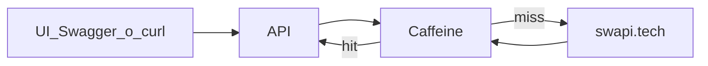

# Challenge Conexa — API Star Wars (SWAPI)

API REST en **Java 21 / Spring Boot 3** que expone el catálogo de [SWAPI](https://www.swapi.tech/) (people, films, starships, vehicles) con registro/login JWT, roles USER/ADMIN, OpenAPI, tests y deploy en Fly.io. Incluye una UI de demo con estética Star Wars.

Repo: https://github.com/duartegaston/challenge-conexa  
Autor: [duartegaston](https://github.com/duartegaston) (Gaston Duarte)

---

## Deploy ([Fly.io](http://Fly.io))

**Aclaracion**: La UI considero que no este dentro del alcance del challenge, fue desarrollado con HTML, CSS y Javascript para poder simplemente las request realizadas y no tener que probarlas por postman por ejemplo.

| Recurso | URL |
|---------|-----|
| App | https://challenge-conexa.fly.dev |
| **Swagger UI** | https://challenge-conexa.fly.dev/swagger-ui.html |
| OpenAPI JSON | https://challenge-conexa.fly.dev/v3/api-docs |

La máquina se apaga por inactividad (`auto_stop_machines`): el primer request después de un rato puede tardar varios segundos (**cold start**).

Para desplegar (no necesario): `fly secrets set JWT_SECRET="$(openssl rand -base64 48)"` y `fly deploy`. Sin `JWT_SECRET` la app no arranca.

---

## Cómo correr local en caso de querer probarlo de esta forma.

### Requisitos

- Java 21+ (el wrapper `./mvnw` descarga Maven)

### Arranque (perfil `local`: H2 en memoria + Flyway)

```bash
./mvnw spring-boot:run
```

| Recurso | URL |
|---------|-----|
| UI login | http://localhost:8080/ |
| UI catálogo | http://localhost:8080/app.html |
| Health | http://localhost:8080/actuator/health |
| **Swagger UI** | http://localhost:8080/swagger-ui.html |
| OpenAPI JSON | http://localhost:8080/v3/api-docs |

---

## Usuarios, registro y login

Hay dos formas de tener un usuario:

- **Registrarse:** `POST /api/v1/auth/register` crea un usuario con rol USER (el rol no se puede elegir). No fue agregado a la UI con el fin de evitar complejidad a nivel frontend ya que considero que no aplica al caso.
- **Usuarios de demo**, sembrados al arrancar si no existen (`UserDataSeeder`):

| Username | Password | Roles |
|----------|----------|-------|
| `user` | `user123` | USER |
| `admin` | `admin123` | USER, ADMIN |

Los usuarios se guardan en H2 (passwords con BCrypt). Las passwords de demo son públicas: **solo para demo**.

```bash
curl -s -X POST http://localhost:8080/api/v1/auth/register \
  -H 'Content-Type: application/json' \
  -d '{"username":"luke","password":"s3cret-pass"}'
# 201 {"username":"luke","roles":["USER"]}   ·   409 si ya existe

curl -s -X POST http://localhost:8080/api/v1/auth/login \
  -H 'Content-Type: application/json' \
  -d '{"username":"luke","password":"s3cret-pass"}'
# {"accessToken":"...","tokenType":"Bearer","expiresIn":3600,"roles":["USER"]}
```

### Recursos

```bash
TOKEN=$(curl -s -X POST http://localhost:8080/api/v1/auth/login \
  -H 'Content-Type: application/json' \
  -d '{"username":"user","password":"user123"}' | jq -r .accessToken)

curl -s "http://localhost:8080/api/v1/people?page=1&limit=5&name=sky" -H "Authorization: Bearer $TOKEN"
curl -s http://localhost:8080/api/v1/people/1 -H "Authorization: Bearer $TOKEN"
curl -s "http://localhost:8080/api/v1/people?id=1&name=sky" -H "Authorization: Bearer $TOKEN"
curl -s "http://localhost:8080/api/v1/films?title=hope" -H "Authorization: Bearer $TOKEN"
```

Listado: `{ "content", "page", "limit", "total", "hasNext" }`. `page` ≥ 1, `limit` entre 1 y 100 (default 10).

**Filtros** (se pueden usar solos o combinados):

- `name` (o `title` en films): busca en SWAPI por coincidencia parcial, sin distinguir mayúsculas.
- `id` (numérico): devuelve una página con 0 o 1 elementos (vacía si el id no existe, no es un error). Si se combina con `name`/`title`, el elemento debe cumplir ambos.
- Para el detalle completo de un id, `GET /{recurso}/{id}` (404 si no existe).

### Errores

Todos los errores son `application/problem+json`:

```json
{ "type": "about:blank", "title": "Bad Request", "status": 400, "detail": "Validation failed",
  "instance": "/api/v1/people", "errors": { "limit": "must be less than or equal to 100" } }
```

| Status | Cuándo |
|--------|--------|
| 400 | Parámetro o body inválido (`errors` indica el campo) |
| 401 | Sin token, token inválido/vencido, o credenciales incorrectas |
| 403 | Token válido pero sin el rol requerido |
| 404 | Id inexistente en SWAPI |
| 409 | `register` con un username que ya existe |
| 502 | SWAPI caído, lento o con respuesta inválida |

---

## UI demo a nivel local

1. http://localhost:8080/ — login o "Crear una" cuenta (JWT en `sessionStorage`)
2. http://localhost:8080/app.html — tabs, filtros por nombre y/o id, paginación y detalle; con el usuario `admin` aparece "Vaciar caché"
3. Un 401 devuelve al login

Tipografía Orbitron / Exo 2 (Google Fonts); fondo espacial; acentos oro crawl + azul sable.

---

## OpenAPI / Swagger (local)

- UI: http://localhost:8080/swagger-ui.html
- Spec: http://localhost:8080/v3/api-docs
- Security scheme `bearerAuth` (JWT). Login y registro son públicos.
- Flujo sugerido: `POST /api/v1/auth/login` → **Authorize** con el `accessToken` → probar `GET /api/v1/people`.

## Endpoints

Base: `/api/v1`.

| Método | Path | Acceso | Notas |
|--------|------|--------|-------|
| POST | `/auth/login` | Público | Emite JWT |
| POST | `/auth/register` | Público | Crea usuario USER |
| GET | `/auth/me` | Autenticado | Usuario y roles |
| GET | `/people` · `/people/{id}` | USER | `page`, `limit`, `id`, `name` |
| GET | `/films` · `/films/{id}` | USER | `page`, `limit`, `id`, `title` (o `name`) |
| GET | `/starships` · `/starships/{id}` | USER | `page`, `limit`, `id`, `name` |
| GET | `/vehicles` · `/vehicles/{id}` | USER | `page`, `limit`, `id`, `name` |
| DELETE | `/admin/cache` | ADMIN | Vacía las cachés de SWAPI (204) |
| GET | `/actuator/health` | Público | Liveness |

---

## Decisiones

| Decisión                                                       | Por qué                                                                                                                                                                                                                                                                                         |
| -------------------------------------------------------------- | ----------------------------------------------------------------------------------------------------------------------------------------------------------------------------------------------------------------------------------------------------------------------------------------------- |
| **REST API**                                                   | Simplicidad y menor sobrecarga.                                                                                                                                                                                                                                                                 |
| **JWT Bearer + Spring Security + roles**                       | Stateless para API REST (UI, Swagger, curl) sin sesión en servidor. Spring Security + roles cubren authz sin OAuth/IdP (sobrepeso para el challenge) ni Basic Auth (poco apto para SPA). Toda la autorización por ruta vive en `SecurityConfig`.                                                |
| **Registro de usuarios + login**                               | El requisito pide un login seguro: con registro el sistema es completo y la persistencia en H2 tiene sentido. Passwords con BCrypt; el rol de un registro siempre es USER.                                                                                                                      |
| **Spring** `RestClient` **→ swapi.tech + timeouts + Caffeine** | SWAPI es la fuente de verdad; `RestClient` es nativo del stack MVC (se construye desde el builder de Boot, conserva métricas); Caffeine mitiga la latencia (de la docu de SWAPI); sin dependencias de terceros del dominio Star Wars.                                                           |
| **Paginación normalizada (**`PageResponse`**)**                | Contrato estable hacia la UI. SWAPI solo pagina el listado sin filtro; búsquedas y films devuelven todo junto, así que en ese caso se pagina en memoria.                                                                                                                                        |
| **Errores con** `ProblemDetail`                                | Estándar de Spring 6, formato único para errores de dominio, validación y seguridad (401/403 incluidos).                                                                                                                                                                                        |
| **Controllers sin** `ResponseEntity` **en el caso feliz**      | Controllers finos: el tipo de retorno + `@ResponseStatus` fijan el status; los errores salen de `@RestControllerAdvice`.                                                                                                                                                                        |
| **Clases base para el catálogo**                               | `AbstractCatalogController` y `AbstractCatalogService` evitan repetir el mismo código en people/starships/vehicles. Films queda aparte porque acepta `title`.                                                                                                                                   |
| **Solo H2 + Flyway (para usuarios)**                           | El challenge no persiste el catálogo. H2 en memoria (local/test) o en archivo (prod) alcanza, y Flyway versiona el esquema. Se dejó de lado PostgreSQL: si más adelante se migra, el SQL de Flyway es estándar y alcanza con agregar el driver y un perfil/URL (hoy no hay driver en el build). |
| `JWT_SECRET` **sin default en prod**                           | El valor de `local`/`test` es solo para desarrollo; en `prod` la app no arranca sin secreto (validado al bindear la configuración).                                                                                                                                                             |
| **Maven + Java 21 + capas clásicas MVC**                       | Packages `config`/`controller`/`service`/`model`/`repository`/`security`/`client`/`exception`.                                                                                                                                                                                                  |
| **SonarCloud vía GitHub Actions**                              | Calidad y cobertura (JaCoCo) visibles en cada push/PR.                                                                                                                                                                                                                                          |
| **Deploy Fly.io + Docker multi-stage (Java 21)**               | Path simple de deploy; `JWT_SECRET` vía Fly secrets.                                                                                                                                                                                                                                            |
| **Cursor + SDD (plan → fases → ejecución)**                    | Alcance controlado y entregas incrementales.                                                                                                                                                                                                                                                    |

---

## Metodología: Cursor + SDD

Utilicé Cursor para el desarrollo, con una metodología Spec Driven Development: primero le di el contexto con todas las especificaciones, luego generé un plan con fases de implementación puliendo detalles y tomando decisiones, y después de cada fase hice una review de lo desarrollado antes de pasar a la ejecución y pruebas.

1. **Plan** — alcance, ADRs y fases.
2. **Fases** — checklist + Definition of Done.
3. **Ejecución** — una fase a la vez.

Las reglas y el contexto para el agente viven en `.cursor/` (uso local, no se versiona).

---

## Arquitectura en capas

```
com.conexa.challenge
├── config       # Security, OpenAPI, Cache, RestClient, properties
├── controller   # Auth, Admin y recursos REST (AbstractCatalogController)
├── service      # Auth, catálogo (AbstractCatalogService), cache admin, seed
├── client       # SwapiClient (RestClient + caché), SwapiMapper, respuestas de SWAPI
├── security     # JwtService, filtro JWT, UserDetails, errores 401/403
├── model        # UserEntity, Role + dto/
├── repository   # UserRepository
└── exception    # GlobalExceptionHandler (ProblemDetail) + excepciones de dominio
```

---

## SWAPI + caché

SWAPI es un servicio externo: cada listado o ficha suma latencia de red. Caffeine guarda esas respuestas en memoria del proceso para no volver a pegarle al origen en cada request igual.

No reemplaza a SWAPI. Si el dato no está o venció el TTL, el cliente va al origen y guarda el resultado. Errores y 404 no se cachean. Hay dos cachés, cada una con su TTL, para que la clave de una página no pise la de un detalle:

| Caché | Clave | TTL (default) |
|-------|-------|---------------|
| `swapi-lists` | recurso + page + limit + filtro (sin distinguir mayúsculas) | 5 minutos |
| `swapi-details` | recurso + id | 1 hora (los detalles casi no cambian) |

Configurable en `swapi.cache.*`; el tope de entradas (`max-size`, default 300) limita la RAM en la VM de 512 MB. `DELETE /api/v1/admin/cache` las vacía.



- **Origen:** https://www.swapi.tech/api (`swapi.base-url`)
- **Cliente:** Spring `RestClient` (sin SDK Star Wars)
- **Timeouts:** `swapi.connect-timeout`, `swapi.read-timeout`
- **Errores:** origen caído, lento o con respuesta ilegible → **502**
- **Paginación:** el listado sin filtro lo pagina SWAPI (`total_records`, `next`). Las búsquedas y `/films` devuelven todo junto y se paginan en memoria.
- **Tests:** WireMock / mocks — **nunca** red real a SWAPI en CI

---

## Tests

```bash
./mvnw verify          # tests + reporte de cobertura (target/site/jacoco/index.html)
```

| Tipo | Ejemplos |
|------|----------|
| Unit | `JwtServiceTest`, `JwtAuthenticationFilterTest`, `AuthServiceTest`, `CatalogServicesTest`, `SwapiMapperTest`, `PageResponseTest`, `UserDataSeederTest`, `GlobalExceptionHandlerTest` |
| Slice | `@DataJpaTest` `UserRepositoryTest` (esquema real de Flyway) |
| Integración | `@SpringBootTest` + H2 con login real: `AuthIntegrationTest`, `CatalogResourcesIntegrationTest` (parametrizado por recurso), `AdminIntegrationTest`, y `SwapiClientTest` contra WireMock |

---

## Calidad / CI

`.github/workflows/ci.yml` corre en cada push a `main` y en cada PR:

1. `./mvnw verify` — tests y cobertura JaCoCo.
2. Análisis de **SonarCloud**, con el secret `SONAR_TOKEN` del repo (se saltea en PRs desde forks, que no reciben secrets). La configuración del proyecto está en las propiedades `sonar.`* del `pom.xml`.

---

## Posibles mejoras a futuro

- Refresh tokens / rotación de secretos JWT
- Protección contra fuerza bruta en el login (rate limiting)
- Stale-if-error en la caché de SWAPI
- Observabilidad (request id, métricas de caché en un dashboard)
- Migrar a PostgreSQL (driver + perfil) si los usuarios dejan de ser solo de demo
